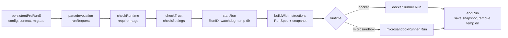
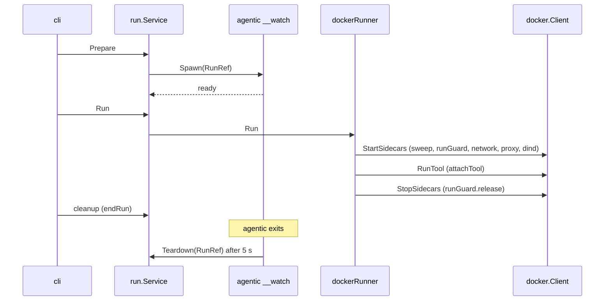
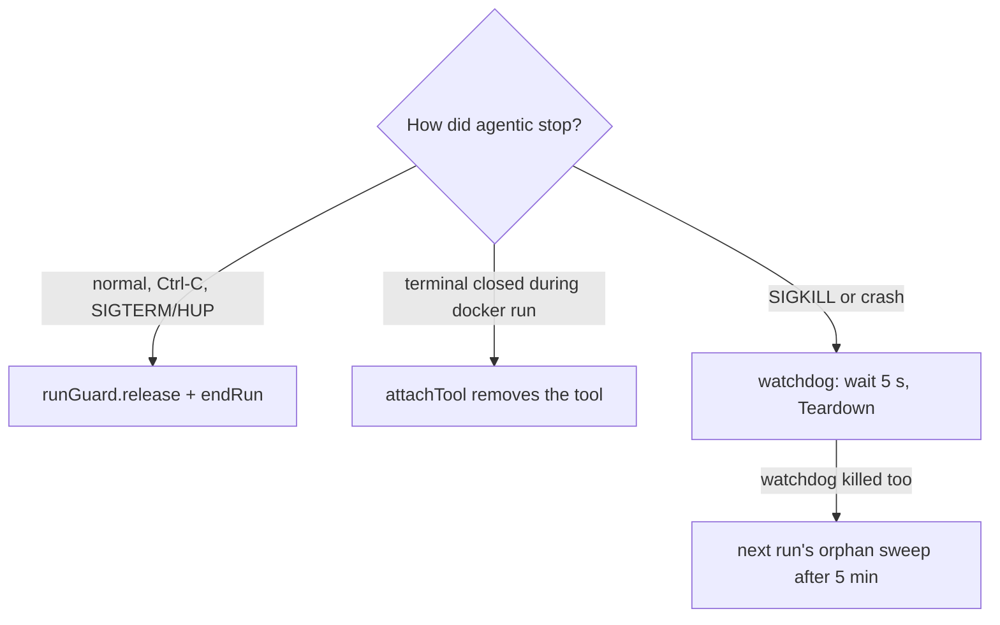

# Run flow

What `agentic run` does, step by step, and where each step lives in the code. The entry point is `runTool` in `internal/cli/run.go`; `run.Service` in `internal/usecase/run` holds the steps, and each runtime has a runner. For what the run isolates and how, see [Security model](security-model.md).

## Overview

How to read it:

- **Before the runner**: everything up to `buildWithInstructions` is `run.Service.Prepare`, which returns the `sandbox.RunSpec` and a cleanup func. It's the same for every runtime.
- **Checks before prompts**: a run the runtime can't do, a bad credential or a missing image fails before the user approves anything.
- **The runner**: `run.Service.Run` picks a runner by runtime; only the runners talk to Docker or msb.
- **The end**: the cli defers Prepare's cleanup, so `endRun` runs after the runner returns, also on an error.

## Docker run over time

How to read it:

- **The watchdog**: a separate, detached process that agentic starts before creating anything. Spawn waits for its ready line, so the run only goes on once its exit is watched.
- **Sidecars**: `StartSidecars` returns a `Sidecars` holding the run's `runGuard`, and `StopSidecars` releases it once the tool exits.
- **After exit**: the watchdog's teardown finds nothing left after a normal run; it matters after a kill. See [Teardown](#teardown).

## Steps

### Startup and parse

| Step | Code | Why |
| --- | --- | --- |
| Root pre-run | `persistentPreRunE` in `internal/cli/root.go` | Loads the project config, resolves the Docker context, migrates `$AGENTIC_HOME`, checks Docker and git, and offers an upgrade. |
| Project dir | `run.CheckProjectDir`, called by `parseInvocation` | Refuses a working dir Docker can't bind-mount, before its config is read. |
| Tool and image | `parseInvocation` in `internal/cli/run.go` | Splits the args into the tool, its image in the namespace and the tool args. |
| Request | `runRequest` in `internal/cli/run.go` | Collects the run flags into a `run.Request`; Prepare resolves them against the config. |

### Prepare

`run.Service.Prepare` in `internal/usecase/run/prepare.go` runs these in order.

| Step | Code | Why |
| --- | --- | --- |
| Runtime check | `checkRuntime` in `runtime.go` | Refuses a run the runtime can't do safely, then runs the runner's own `Check`. |
| Credentials | `credentials.Check` in `internal/network/credentials` | Refuses a bad `[[run.proxy.credentials]]` entry before any prompt. |
| Image | `requireImage` in `image.go` | Fails early when the tool image isn't built, hinting at `--namespace`. |
| Trust | `checkTrust` in `trust.go` | Asks to trust the working dir, unless it already is or `--trust-dir` is set. |
| Settings | `checkSettings` in `trust.go` | Asks to approve changed guarded settings; the `approvedConfig` it returns is the only config a run reads. |
| Tool | `checkTool` in `prepare.go` | Offers a due tool update and creates the tool's host files. |
| Config | `approvedRun` → `resolveRun` in `prepare.go` | Resolves the flags against the approved config into one `runConfig`, which every later step reads. |
| Start | `startRun` in `runtime.go` | Creates the RunID, spawns the watchdog and creates the run temp dir, before anything the run can leave behind. |
| RunSpec | `buildWithInstructions` in `runspec.go` | Writes the instructions snapshot, then builds the RunSpec with it mounted. |

`buildWithInstructions` calls `buildInstructions` and `prepareInstructions` (`instructions.go`), then `build` (`runspec.go`):

| Step | Code | Why |
| --- | --- | --- |
| Marketplaces | `syncToolMarketplaces` | Syncs the tool's plugin marketplaces and returns their mounts. |
| Mounts | `newMountSet` in `mounts.go` | Assembles and checks the volumes, so an unchecked set never reaches a runtime. |
| Env | `runEnv` | Resolves the env, refuses managed names and checks the credentials against it. |
| Spec | `newRunSpec` | Assembles the `sandbox.RunSpec`, including the egress policy and the Docker daemon. |
| Proxy CA | `checkProxyTrust` in `credentials.go` | When the proxy decrypts, refuses an image whose entrypoint can't trust its CA. |

### Run

`run.Service.Run` in `internal/usecase/run/runtime.go`:

| Step | Code | Why |
| --- | --- | --- |
| Runner | `runner` in `runtime.go` | Picks the Docker or microsandbox runner. |
| Spec check | `checkSpec` in `capabilities.go` | Refuses a RunSpec that needs a feature the runtime lacks, a backstop for `checkRuntime`. |
| Mounts | `recheckMounts` in `mounts.go` | Checks the mounts again, see [why](#why-the-mounts-are-checked-again). |

### Docker runner

`dockerRunner.Run` in `internal/usecase/run/docker.go`, calling `docker.Client` in `internal/runtime/docker`:

| Step | Code | Why |
| --- | --- | --- |
| Host | `prepareDockerHost` | Creates the named volumes and the proxy log dir and builds missing sidecar images. |
| Sidecars | `StartSidecars` → `setupSidecars` in `sidecar.go` | Sweeps orphans, installs the `runGuard`, then creates the run network, the proxy and the dind sidecar. |
| Proxy | `setupProxy` in `proxy.go` | Starts the proxy when enabled and returns the tool's proxy env. |
| Docker | `setupDind` in `dind.go` | Starts the dind sidecar when enabled and returns the tool's Docker args. |
| Tool | `RunTool` → `buildRunArgs` in `runargs.go`, `attachTool` in `run.go` | Runs the tool container attached to the terminal, removing it on a signal. |
| Stop | `StopSidecars` in `run.go` | Releases the `runGuard`, which tears the run down. |
| Summary | `printProxySummary` in `proxysummary.go` | Reports the blocked hosts from the proxy log, after the proxy stops. |

`recheckMounts` runs again before `StartSidecars` and before `RunTool`.

### Microsandbox runner

`microsandboxRunner.Run` in `internal/usecase/run/microsandbox.go`:

| Step | Code | Why |
| --- | --- | --- |
| dockerd image | `ensureDockerdImage` | With `--dind`, builds the tool image with Docker's daemon added. |
| msb image | `microsandboxRef`, `ensureMicrosandboxImage` | Loads the image into msb unless it already holds this build. |
| Tool | `microsandbox.Client.Run` in `internal/runtime/microsandbox` | Runs the tool VM, with msb enforcing the allowlist. |
| Proxy | `runThroughProxy` → `StartPublishedProxy` in `proxypublish.go` | With `backend = "agentic"`, starts agentic-proxy on host loopback and routes the VM through it. |

### End

| Step | Code | Why |
| --- | --- | --- |
| Cleanup | Prepare's cleanup, deferred in `runTool` | Calls `endRun`, also when Prepare or Run failed. |
| Instructions | `endRun` → `saveSnapshot` in `instructions.go` | Saves the instructions snapshot back to the tool's file. |
| Temp dir | `endRun` → `sandbox.RemoveRunTempDir` | Removes `$TMPDIR/agentic-run-<id>/`. |

## Why the mounts are checked again

`newMountSet` checks the mounts when Prepare builds the RunSpec, but building images and starting sidecars can take long enough for a path to change, for example into a symlink. So `recheckMounts` runs again right before each start: in `Run`, before the sidecars and before the tool.

## Teardown

Every per-run resource derives from one `sandbox.RunID`, which `run.Service.Prepare` creates before anything the run leaves behind. Containers and networks carry `agentic.run`, `agentic.owner` and `agentic.started` labels. Host files go in `$TMPDIR/agentic-run-<id>/` (the instructions snapshot, the proxy token and msb env files), except the dind run dir and the proxy log under `$AGENTIC_HOME`.

Each runtime's `Teardown(runID)` removes one run, best-effort and idempotent; every exit path, the sweep and `agentic clean`/`prune` use it. `run.Service.Teardown` adds the runtime-neutral part: it saves a leftover instructions snapshot back to the tool's file, then removes the run temp dir.

Several layers call it, each covering what the one before can't:

| Layer | Covers | Code |
| --- | --- | --- |
| `runGuard` | Normal exit, Ctrl-C, `SIGTERM`, `SIGHUP` | `internal/runtime/docker/guard.go` |
| `attachTool` | A closed terminal detaching `docker run` | `internal/runtime/docker/run.go` |
| Watchdog | `SIGKILL` or a crash of agentic | `internal/usecase/watch`, `internal/cli/watch.go` |
| Orphan sweep | The watchdog killed too, after 5 minutes | `internal/runtime/docker/sweep.go` |
| Stale run dir sweep | A run that left only its dind run dir, after 10 minutes | `internal/runtime/docker/sweep.go` |

`runGuard.release` tears the run down before it stops catching signals, so a second Ctrl-C can't cut the teardown short. The watchdog is a detached, hidden `agentic __watch` that reaps the run: once agentic exits, it waits 5 seconds, then tears the run down once. The wait lets a `docker` call in flight at the kill finish first, as it outlives agentic and can still create a container.
