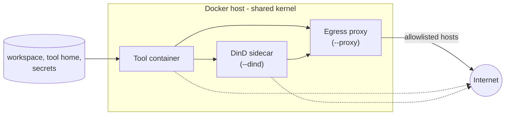

# Security model

A plain-language map of how agentic isolates a tool: each layer, what it stops, and what it doesn't. The threat is the agent itself - a bug, a bad decision, or a prompt injection in something it reads. The goal: it can only touch what you hand it.

## The map



How to read it:

- **Files**: the tool only sees what's mounted: the workspace and its own home (writable), and secrets (read-only). The DinD sidecar only sees the workspace.
- **Docker**: the tool talks to its own DinD sidecar over mTLS, never to the host's Docker daemon. Inner containers run inside the sidecar.
- **Network**: each run gets its own Docker network, shared only with its own sidecars. With `--proxy` that network is internal, so all traffic from the tool and the sidecar goes through the egress proxy, which only lets allowlisted hosts through. Without it (dotted lines), both reach the internet directly.
- **Kernel**: everything inside "Docker host" shares one Linux kernel. That's the boundary all layers below ultimately rest on.
- **Microsandbox**: with `--runtime microsandbox` the tool runs in a VM with its own kernel instead. There are no sidecars: msb enforces the allowlist and injects credentials from the host side, and `--dind` runs dockerd inside the VM.

## Layers

> [!WARNING]
> The core container hardening and mounts are the well-tested part. The egress proxy, credential injection and DinD sidecar are **beta**, and the microsandbox runtime is newer still: they're under active development and not yet tested as thoroughly, so don't rely on them as your only safeguard yet.

| Layer | What it stops | What it doesn't stop | Code |
| --- | --- | --- | --- |
| **Tool container**: read-only root, all capabilities dropped, `no-new-privileges`, your uid/gid, pid/cpu/memory limits | Changing the system, becoming root, fork bombs and runaway memory | Anything it can do with the mounts it's given; a kernel bug | `internal/docker/runargs.go` |
| **Mounts**: only `/workspace`, the tool's own home dir, read-only secrets, and extra `--volume`/`mounts` bind mounts (read-only unless `:rw`) | Reading the rest of your files (`~/.ssh`, other repos, browser data); [mount tricks](volume-mounts.md#mount-safety) via planted symlinks or `agentic.json`/`state.json` | Reading everything that *is* mounted, including its own credentials and secrets; editing the workspace | `internal/tools/<tool>.go`, `internal/mount` |
| **Run network**: each run gets its own Docker network | Reaching other agentic runs and containers on other Docker networks | Reaching the internet, the Docker host and ports published on it, all without `--proxy` | `internal/docker/network.go` |
| **Egress proxy** (opt-in, `--proxy`): tool sits on an `--internal` network with no gateway on the Docker host, so its only way out is the proxy | Talking to hosts not on the allowlist or to services on the Docker host; containers outside the run's network using the proxy; every attempt is logged | Sending data to an allowlisted host (filtering is by host, not content) | `internal/proxy`, `internal/docker/proxy.go` |
| **Credential injection** (opt-in, `[[run.proxy.credentials]]`): the proxy holds API keys and swaps them in for the placeholder the tool sends to their hosts | Reading or leaking a configured API key | Using the key through its hosts during the run; OAuth tokens in the tool home | `internal/proxy`, `internal/credentials`, `internal/usecase/run/credentials.go` |
| **DinD sidecar** (opt-in, `--dind`): rootless dockerd in its own container, mTLS, seccomp filter, no setuid binaries, sees only `/workspace` | Access to the host's Docker socket (= root on your machine); host files outside `/workspace` | Inner containers get namespaced `SYS_ADMIN`/`NET_ADMIN`, so more kernel surface; an inner container can read the sidecar's own files (incl. its TLS key); direct internet access without `--proxy`; `docker push` to an allowlisted registry | `internal/docker/dind.go`, `internal/dind` - see [Docker-in-Docker](docker-in-docker.md) |
| **Microsandbox runtime** (opt-in, `--runtime microsandbox`): the tool runs in a microVM with its own kernel instead of a container | A kernel exploit reaching the host; host files outside the mounts | A VM escape, which lands in msb's process running as your user; the [differences from Docker](microsandbox.md#whats-different-from-docker) (no read-only root, no secret mounts, no pid limit, [root in the VM](microsandbox.md#docker-in-the-vm) with `--dind`) | `internal/microsandbox`, `internal/usecase/run/microsandbox.go` - see [Microsandbox runtime](microsandbox.md) |
| **Build**: tool install scripts [checksum-verified](images.md#install-script-checksums) against a pinned SHA256 | A tampered or swapped install script | A malicious release of the tool itself | `internal/tools` |

## Leftover risk

What no layer covers today:

- **Shared kernel**: a kernel exploit escapes every container. Only a VM boundary (the [microsandbox runtime](microsandbox.md), Kata, gVisor, [Docker Sandboxes](comparison.md)) fixes this. Keep the host kernel patched.
- **Credentials in reach**: the agent can read its OAuth login token in the tool home and any `--secret` you mount, and use them from any allowed host. [Proxy-injected API keys](credential-injection.md) stay out of reach unless a host [echoes them in a body](credential-injection.md#limitations), but can still be used.
- **Workspace tampering**: the agent can edit git hooks, `Makefile`, `package.json` scripts, etc. They run on *your* machine the next time you use them outside the container. The same goes for `.agenticrc.toml`, though [risky keys](config.md#setting-approval) need your approval. Review diffs.
- **Shared tool state**: hooks or MCP servers the agent plants in its tool home also run in your other projects. Use a separate `--home` for untrusted ones.
- **Exfiltration to allowed hosts**: without `--proxy` the internet is open to the tool and the DinD sidecar; with it, data can still go to any allowlisted host.
- **Fronting with Encrypted Client Hello**: the proxy [checks the TLS server name](egress-proxy.md#tls-server-name-check) of each tunnel, but with ECH the tool can encrypt the real name. A CDN that supports ECH may then serve another of its sites through an allowed host.
- **Killed agentic**: when its terminal closes or it gets `SIGTERM`, agentic removes the tool container and sidecars. If agentic is killed with `SIGKILL` or crashes, the tool keeps running without you: find it with `docker ps` and remove it with `docker rm --force <name>`.
- **DNS on other engines**: Docker Engine before 26 forwards DNS lookups from the tool's `--internal` network to outside resolvers, so agentic refuses it. It can't check other engines, so with `--proxy` data may still leak there in names like `<data>.example.test`.

## Check it yourself

Run these inside the tool container:

```bash
touch /etc/test                    # fails: Read-only file system
grep CapEff /proc/self/status      # 0000000000000000: no capabilities
grep NoNewPrivs /proc/self/status  # 1: can't gain privileges
ls ~/.ssh                          # fails: not mounted
curl -I https://example.com        # with --proxy and not allowlisted: CONNECT tunnel failed, response 403
```

## Glossary

- **Capability**: a slice of root's power (e.g. `CHOWN`, `NET_ADMIN`). Dropping all of them means even uid 0 can do little.
- **Namespace**: the kernel giving a process its own view of something (processes, network, mounts, users). Containers are mostly namespaces.
- **User namespace**: maps "root inside" to an unprivileged uid outside. Rootless Docker is built on this.
- **Rootless**: dockerd runs as your user instead of root, so its "root" is fake.
- **seccomp**: a list of syscalls a process may make; everything else is refused by the kernel.
- **AppArmor**: a kernel policy limiting which files and actions a program may use.
- **`no-new-privileges`**: blocks gaining privileges through setuid binaries or file capabilities.
- **mTLS**: both sides prove who they are with certificates, so only the tool can drive the sidecar's daemon.
